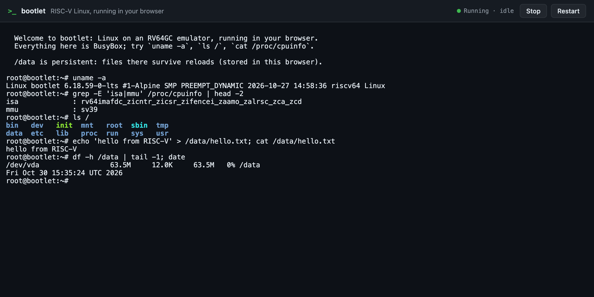
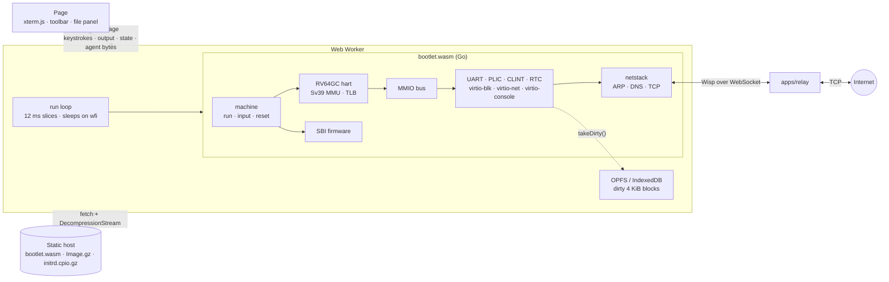
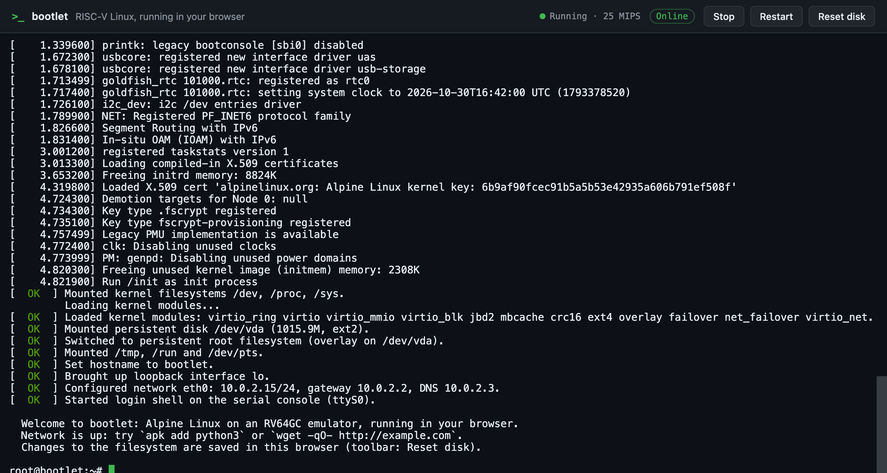
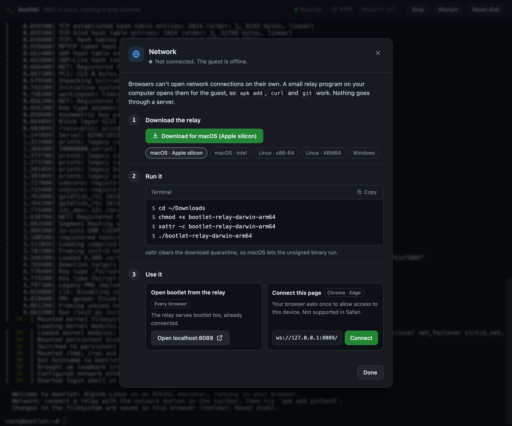
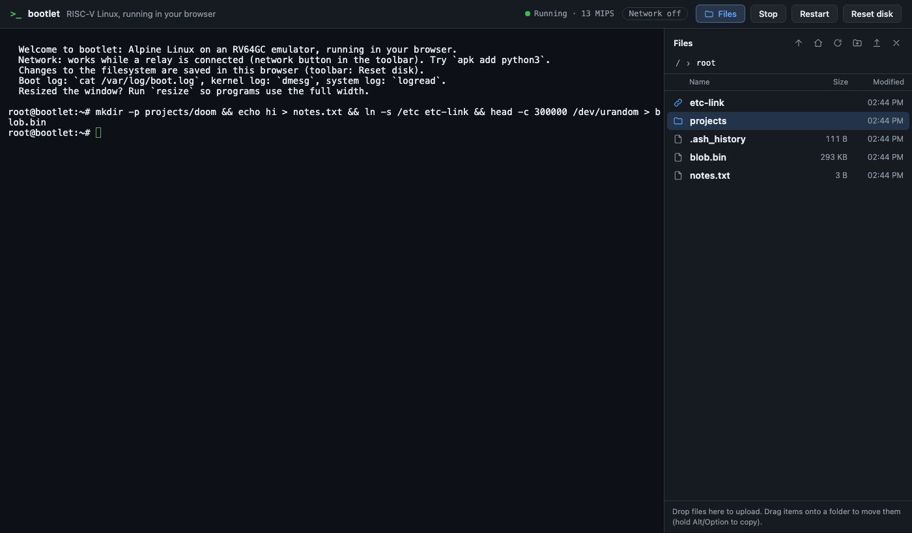

<div align="center">


# bootlet

**A real RISC-V Linux machine, booting to a shell entirely in your browser.**

[](https://github.com/bpradana/bootlet/actions/workflows/pages.yml)
[](https://bpradana.github.io/bootlet/)


[](LICENSE)

[Quick start](#quick-start) ·
[How it works](#how-it-works) ·
[Networking](#networking) ·
[Emulator API](#emulator-api) ·
[Development](#development)

</div>

---

bootlet is an RV64GC (64-bit RISC-V) machine emulator written in Go and compiled to
WebAssembly. Open the page and it boots an unmodified Linux kernel with an Alpine
userland, then hands you a root shell on a serial console. Run the small relay program
on your computer and the guest gets a network, so you can `apk add` real packages:
Python, curl, git, compilers. Everything you install or change is saved in your browser.

There is no server-side VM, container, or SSH session behind it. Every instruction runs
in a Web Worker on your machine, and the site deploys as plain static files to any host.
Browsers can't open network connections on their own, so the optional relay on your own
computer forwards the guest's traffic; nobody has to host a server. The same emulator
also builds natively, so it can be run and tested from a terminal.

```console
root@bootlet:~# apk add -q python3
root@bootlet:~# python3 -c 'import platform, sys; print("Python", sys.version.split()[0], "on", platform.machine())'
Python 3.14.10 on riscv64
```

<div align="center">

<br><sub>Python and curl installed with <code>apk</code>, still there after a page reload.</sub>
</div>

## Contents

- [Features](#features)
- [Quick start](#quick-start)
- [How it works](#how-it-works)
- [The guest](#the-guest)
- [Networking](#networking)
- [Persistent storage](#persistent-storage)
- [File explorer and system stats](#file-explorer-and-system-stats)
- [Display, keyboard, and boot splash](#display-keyboard-and-boot-splash)
- [Emulator API](#emulator-api)
- [Performance](#performance)
- [Deployment](#deployment)
- [Development](#development)
- [Troubleshooting](#troubleshooting)
- [Known limitations](#known-limitations)
- [License](#license)

## Features

| | |
|---|---|
| 🧠 **A real RV64GC CPU** | RV64IMAFDC + Zicsr, Zifencei, and Zicntr, with M/S/U privilege modes, traps and delegation, and Sv39 paging with a software TLB. It passes all 134 official riscv-tests (`rv64ui/um/ua/uf/ud/uc/mi/si`). |
| 🐧 **An unmodified kernel** | Alpine's prebuilt `linux-lts` 6.18 boots as shipped. A Go-native SBI firmware replaces OpenSBI, and the device tree is generated at runtime. |
| 📦 **A real package manager** | musl, BusyBox, and `apk` come preinstalled and registered in apk's database, so `apk add` pulls anything from Alpine's riscv64 repositories. |
| 🌐 **Networking** | virtio-net plus a user-mode TCP/IP stack in Go (like QEMU's slirp). Guest connections travel as [Wisp](https://github.com/MercuryWorkshop/wisp-protocol) streams over a WebSocket to a relay running on your own computer, which also serves the site. |
| 💾 **Persistent root filesystem** | The whole filesystem is an overlay on a 1 GiB sparse virtio disk, saved to the Origin Private File System (or IndexedDB). Only changed 4 KiB blocks are written. **Reset disk** restores the stock system. |
| 🖼️ **Graphical display** | A 640×480 framebuffer, driven by the stock kernel's `simpledrm` (`/dev/fb0`, the framebuffer console), drawn on a canvas above the serial console. Only changed regions are copied. The serial console stays as it is. |
| ⌨️ **Keyboard for the display** | A virtio keyboard with real key-down and key-up events, for games and the display's own shell on `tty1`. Held keys are released when the display loses focus. |
| ✨ **Boot splash** | The emulator draws bootlet's power-on screen on the display until Linux draws its first pixel (no firmware involved). `?splash=0` turns it off. |
| 📂 **File explorer** | A side panel browses the guest's whole filesystem. Drop files or folders from your computer to upload them, drag items onto folders to move them, and drag files out (Chrome, Edge) or double-click to download. |
| 📊 **Live system stats** | The panel's System tab shows the guest's CPU, memory, storage, network, and top processes, plus the emulator's speed (MIPS) and memory, with a history graph. |
| ⚡ **Decoded-block cache** | Straight-line runs of guest code are decoded once and cached (bounded, about 7 MiB), with exact instruction counts, precise traps, and invalidation on any write to cached code. In the browser it is about 25–75% faster than the plain interpreter, which remains the reference (`?engine=interp`). |
| 💤 **Idles at idle** | When the guest executes `wfi`, the worker sleeps until the next timer event, keystroke, or network packet, so a VM at a prompt costs almost no CPU. |
| 🧩 **No toolchain for the guest** | `guestpack` (pure Go) downloads and verifies pinned Alpine packages and packs the initramfs. The file explorer's guest agent is cross-compiled by Go itself. No cross compiler, Buildroot, or Docker is needed. |
| 🖥️ **Native and WASM from one codebase** | The `machine` package drives both `cmd/bootlet` (a terminal runner with direct sockets) and `cmd/wasm` (the browser build). |
| 🛠️ **One task runner** | [mise](https://mise.jdx.dev) pins Go, Node, pnpm, and zig, and defines every build, test, and dev workflow. |

## Quick start

**Just try it:** open the [demo](https://bpradana.github.io/bootlet/). It boots offline.

**With networking:** download the relay for your system from the
[latest release](https://github.com/bpradana/bootlet/releases/latest), run it, and open
**http://localhost:8089**. The relay serves bootlet itself and connects the guest to the
internet; it works in every browser. Then try:

```sh
apk add python3 curl git
curl -sI https://example.com | head -1
```

Or keep using the demo site: open the **Network off** button in the toolbar and press
**Connect**. Chrome and Edge ask once to allow the site to access this device. Safari
doesn't allow an HTTPS page to reach `localhost`, so use http://localhost:8089 there.

The toolbar can **Stop** (pause), **Start** (resume), **Restart** (reboot), and **Reset
disk** (wipe your changes). `poweroff` and `reboot` work from the shell too. Page
options: `?mem=256` sets the guest RAM in MiB (the default is 128), `?quiet` hides the
boot log, and `?relay=<ws url>` connects to a specific relay (`?relay=` for none).

### From source

You need [mise](https://mise.jdx.dev). It installs everything else.

```sh
git clone https://github.com/bpradana/bootlet.git && cd bootlet
mise install          # Go, Node, pnpm, zig
mise run relay:build  # build the site and the relay that serves it
./dist-relay/bootlet-relay   # then open http://localhost:8089
```

For frontend work, `mise run web:dev` starts Vite on http://localhost:5173 (connect it to
`mise run relay:dev` from the network menu). To boot the same machine in your terminal,
with networking through your own sockets:

```sh
mise run emu:run      # Ctrl-A x quits; the root filesystem is kept in guest/disk.img
```

## How it works



<div align="center">

<br><sub>The whole boot is visible: the kernel's log from its first instruction, then the guest's <code>[ OK ]</code> steps. The screen is cleared before the prompt; <code>/var/log/boot.log</code> keeps the steps.</sub>
</div>

Opening the page goes through these steps:

1. The worker downloads the WASM, kernel, and initramfs in parallel, and decompresses
   the gzip files with `DecompressionStream`. The guest never decompresses anything at
   emulated speed. At the same time, it loads the saved disk blocks and opens the relay
   WebSocket.
2. Go builds the machine and copies the kernel to `0x80200000`. It places the initramfs
   and a generated device tree at the top of RAM, sets the delegation CSRs that
   firmware would normally leave behind, and enters the kernel in **S-mode**.
3. The kernel's `ecall`s (timer, IPI, remote fence, HSM, reset, debug console) are
   handled in Go, not by M-mode firmware.
4. The guest's `/init` loads the virtio drivers, mounts the disk, and makes it the upper
   layer of an overlay whose lower layer is the initramfs. BusyBox `init` then runs
   `/etc/init.d/rcS`. It mounts `/tmp`, `/run`, `/dev/pts` and `/dev/shm`, applies
   `sysctl.conf`, sets the clock from the RTC, restores the random seed, starts `syslogd`,
   `klogd` and `crond`, and configures `eth0`. Every step prints a systemd-style
   `[  OK  ]` or `[FAILED]` line. Then the screen is cleared, as `getty` would do, before
   the welcome message and the shell. The status lines stay in `/var/log/boot.log`, the
   kernel log in `dmesg`, and service logs in `logread`. `poweroff` and `reboot` run
   `/etc/init.d/rcK`, which stops the services, saves the random seed, and syncs the disk.
   From `/init` on, the console only shows kernel errors, so kernel messages don't tear
   the status lines.
5. The worker calls `run(12ms)` in a loop. Between slices it posts console output, feeds
   keystrokes to the UART, and moves Wisp packets between the emulator and the WebSocket.
   When the guest idles, `run` returns how long until the next timer interrupt, and the
   worker sleeps.

The device tree advertises exactly the extensions the CPU implements. A generic distro
kernel patches in code for any extension it is told about (Zbb, Svpbmt, V, and so on), so
over-claiming would crash it. `satp` rejects Sv48 and Sv57, which is how the kernel
discovers it must fall back to Sv39.

<details>
<summary><b>Source layout</b></summary>

```
packages/emulator/       Go module: the machine, with no frontend dependencies
  cpu/                   hart: decode/execute, CSRs, traps, FPU, RVC table, Sv39 MMU + TLB
  devices/               UART, PLIC, CLINT, RTC, virtio-mmio transport, virtio-blk/-net/-console, sparse disk + journaled mkfs
  netstack/              user-mode network: ARP, ICMP, fake DNS, TCP termination; direct and Wisp upstreams
  fdt/                   device tree blob encoder
  boot/                  RISC-V Image and ELF loaders
  machine/               memory map, device tree, SBI firmware, run loop: the public API
  cmd/bootlet/           native terminal runner (-net, -relay, -disk)
  cmd/wasm/              exposes the machine to JavaScript as globalThis.bootlet
packages/shared/         UI ⇄ worker and file agent protocols (TypeScript), the Wisp protocol (Go, wisp/),
  agent/                 file agent protocol and server (Go); cmd/bootlet-agent is the guest program
apps/frontend/           Vite + xterm.js page, file panel, emulator worker, OPFS/IndexedDB storage, Playwright tests
apps/relay/              Wisp relay server (Go) and its Dockerfile
guest/
  manifest.toml          pinned Alpine packages (sha256), required kernel options, modules
  rootfs/                files overlaid on the initramfs: init, inittab, rcS, apk repositories, motd
  tools/cmd/guestpack    fetch → verify → extract → check → pack, plus apk's installed database
scripts/                 riscv-tests build (zig cc)
.github/workflows/       build, test, and deploy to GitHub Pages
```

</details>

## The guest

The guest is built from prebuilt **Alpine Linux 3.24 riscv64** packages. The only program
compiled for it is `bootlet-agent`, the file explorer's small guest side, which Go
cross-compiles with no extra toolchain. `mise run guest:fetch` runs `guestpack`, which
does the following:

1. Downloads the kernel (`linux-lts`) and the userland (`busybox-static`, `musl`,
   `apk-tools-static`, `alpine-keys`, `ca-certificates-bundle`), and checks each against
   the sha256 pinned in `guest/manifest.toml`.
2. Decompresses the kernel to a raw RISC-V Image (21 MB, 7.1 MB gzip).
3. Reads `/boot/config-*` and fails if any option the emulator relies on is not built
   in, for example the 8250 UART, PLIC, SBI timer, and devtmpfs.
4. Unpacks every userland package and writes apk's installed database
   (`/lib/apk/db/installed`, with package checksums and per-file hashes), so `apk add`
   knows musl and friends are already present.
5. Reads BusyBox's applet table out of the binary, so every applet link is created
   at pack time instead of running `busybox --install` at every boot.
6. Adds the virtio (block, net, console), ext4, and overlay modules with their dependencies, resolved from
   `modules.dep`. It decompresses them and strips their signatures, because verifying a
   signature costs the guest a SHA-256 and an RSA check at emulated speed.
7. Builds `bootlet-agent` (`GOOS=linux GOARCH=riscv64`, 2.4 MB) into `/sbin`.
8. Writes a newc initramfs (11 MB, 5.5 MB gzip) with the `guest/rootfs` files on top.

The default kernel command line shows the boot log from the first instruction
(`earlycon=sbi`; `?quiet` appends `quiet loglevel=3`) and skips boot work that is wasted
under emulation:

```
console=ttyS0 earlycon=sbi no4lvl unaligned_scalar_speed=fast cma=0 initcall_blacklist=jent_mod_init
```

The jitter-entropy self-test alone was about half of the boot time. The kernel's RNG is
seeded from the device tree's `rng-seed` instead.

To change the guest, edit `guest/manifest.toml` (packages, modules, required options) or
the files in `guest/rootfs/`, then run `mise run guest:fetch` again.

## Networking

Browsers can't open TCP sockets, and Alpine's mirrors don't send CORS headers, so a
static page can't reach the network by itself. bootlet splits the problem in two:

- **In the emulator** (`packages/emulator/netstack`), a user-mode network gives the
  guest a LAN, like QEMU's slirp:

  | Address | Role |
  |---|---|
  | `10.0.2.15/24` | the guest (`eth0`, configured at boot) |
  | `10.0.2.2` | gateway; connections to it reach the relay host's `localhost` |
  | `10.0.2.3` | DNS: every name gets a placeholder address from `198.18.0.0/15` |

  The stack terminates the guest's TCP connections itself. When the guest connects to a
  placeholder address, it opens a stream to the **hostname**, so name resolution happens
  at the relay. The emulator never needs UDP.
- **The relay** (`apps/relay`) is a small [Wisp](https://github.com/MercuryWorkshop/wisp-protocol)
  v1 server. One WebSocket carries all of a page's streams, and the relay opens the
  real TCP connections.

### The relay on your computer

<div align="center">

<br><sub>The network menu walks through downloading, running, and connecting the relay.</sub>
</div>

The relay is one self-contained binary (about 22 MB, built per OS by
`.github/workflows/release.yml` when a `v*` tag is pushed). Run it, and it:

- listens on **127.0.0.1:8089** only, so other machines can't use it;
- serves the bootlet website there, with a `relay.json` marker that tells the page to use
  its own origin as the relay (same origin, so no browser prompt and no mixed content);
- accepts WebSocket connections from that page, from `bpradana.github.io`, and from
  `localhost` pages, and refuses other websites.

How a page finds its relay: `?relay=` if given; else the relay that served the page; else
a build-time default (`VITE_RELAY_URL`); else the relay you last connected to from the
network menu. On the public site it never connects on its own the first time, because
that would show every visitor a browser permission prompt.

| Browser | http://localhost:8089 (served by the relay) | Demo site + **Connect** |
|---|---|---|
| Chrome, Edge | ✅ | ✅ after a one-time "access other apps and services on this device" prompt |
| Safari | ✅ | ❌ blocked as mixed content (HTTPS page → `ws://`) |
| Firefox | not tested yet | not tested yet |

macOS may refuse to open the downloaded binary ("cannot be verified"). Allow it in
**System Settings → Privacy & Security**, or run `xattr -d com.apple.quarantine
bootlet-relay-darwin-*`.

The relay is restrictive by default, because an open TCP relay can be abused:

| Flag | Default | Effect |
|---|---|---|
| `-addr` | `127.0.0.1:8089` | listen address; `:8089` accepts other machines |
| `-origins` | `bpradana.github.io,localhost:*,127.0.0.1:*` | page origins allowed to connect (`*` for any); the relay's own pages are always allowed |
| `-ports` | `80,443,9418,22` | destination ports allowed (`all` for any) |
| `-allow-private` | off | loopback, private, link-local, CGNAT, and metadata addresses are refused after DNS resolution; the checked address is the one dialed, so DNS rebinding can't bypass it |
| `-max-streams` | `64` | concurrent connections per page |
| `-site` | on | serve the bundled website |

You can still host a shared relay (for example `docker build -f apps/relay/Dockerfile`,
behind TLS, with `-origins` set) and point pages at it with `?relay=wss://…` or the
`RELAY_URL` repository variable. The native runner doesn't need a relay: `-net` uses the
host's own sockets, and `-relay ws://…` goes through one to test that path.

## Persistent storage

The root filesystem survives page reloads:

- The disk is a 1 GiB **sparse** virtio block device: only written blocks take memory
  or storage, so a fresh system costs about 200 KB. BusyBox has no `mkfs`, so the
  emulator formats a new disk itself, with an 8 MiB **journal** (ext3 layout, mounted
  by the ext4 driver).
- `/init` mounts it (`commit=1`) as the upper layer of an **overlay** on top of the
  initramfs. Everything you write, from `apk add` to `/root` and `/etc`, lands on the
  disk. `/tmp` and `/run` are tmpfs.
- Every 2 seconds, and when the machine stops, the worker collects the 4 KiB blocks
  written since the last save. It stores them in the **Origin Private File System**, or
  in **IndexedDB** where OPFS sync handles aren't available. In OPFS, blocks are stored
  back to back with an index, so storage use matches what was written, not the disk size.
- **The disk's contents don't sit in memory.** With OPFS, the emulator reads blocks from
  storage on demand, synchronously, through the worker's OPFS access handle. Only blocks
  written since the last save stay in memory. After a reload with 64 MB on the disk, the
  emulator uses about 14 MiB more than a fresh boot (`e2e/boot.spec.ts` checks this).
  The IndexedDB fallback is asynchronous, so there everything is loaded into memory at
  boot. Hover the status indicator to see the emulator's memory use.
- **Reset disk** wipes the saved blocks and reboots into the stock system.

**Reloading or closing the tab is a power cut.** Whatever the guest wrote after the last
save is lost, so the saved disk is the device as it was at that moment. Two things make
that safe:
- **Each save is atomic.** IndexedDB saves run in one transaction. OPFS saves go through a
  write-ahead log, so a tab closed mid-save keeps the whole batch or none of it.
- **The kernel replays the journal** on the next mount, like after a crash on real
  hardware.

At worst, the last few seconds of changes are gone: `/etc/sysctl.conf` makes the guest
write changed file data out within a second (Linux's default is 30 s), the journal
commits every second, and the browser saves every 2 s. The filesystem itself stays
consistent. `TestCrashConsistency` checks this by "reloading" a guest in the middle of
heavy file churn.

Hover the status indicator to see which backend is in use. The native runner keeps the
same disk format in a sparse file (`-disk guest/disk.img`).

## File explorer and system stats

<div align="center">

</div>

**Files** in the toolbar opens a panel next to the terminal. It browses the guest's
whole filesystem:

- **Upload:** drop files or folders from your computer onto the panel (or onto a folder
  in it), or use the upload button. Each file is written to `name.bootlet-part` and
  renamed into place when complete, so an interrupted upload never looks finished. If a
  name is taken, you choose Replace, Keep both, or Skip.
- **Move and copy:** drag items onto a folder or onto a part of the path. Hold Alt/Option
  to copy instead.
- **Download:** double-click a file, or use Download in its menu. In Chrome and Edge you
  can also drag a file of up to 8 MB onto your desktop. The panel fetches it when you
  hover over it.
- **Everything else:** right-click for rename (F2), delete (Delete), copy path, and
  "insert path in terminal". Dragging an item onto the terminal also types its path.
  Backspace goes up a folder.

The guest side is `bootlet-agent`, a small Go program that init starts and restarts. It
talks to the page over a virtio console port (`/dev/vport0p0`, named `bootlet.agent`) in
a framed protocol: a JSON header plus raw bytes (`packages/shared/agent`). The worker
only relays bytes. Files move in 256 KiB chunks at about 4.5 MB/s up and 10 MB/s down
natively, and a few times slower in the browser. Panel width changes the terminal
width, so run `resize` afterwards.

The **System** tab shows live stats:

- **Guest:** CPU (user, system, and I/O wait, with a two-minute graph), memory (used,
  cache, free), the persistent disk and `/tmp`, network throughput, uptime and load,
  and the top processes by CPU and memory.
- **Emulator:** speed in MIPS (with a graph), the tab's memory, and the browser storage
  in use.

The agent reads the guest numbers from `/proc` every 2 s, but only while the tab is on
screen. Each poll costs the guest about 1.7M instructions, a few percent of its CPU at
browser speed. The agent itself shows up in the process list. It skips kernel threads,
which are most of the guest's tasks and the expensive part to read.

## Display, keyboard, and boot splash

The display is separate from the serial console. Console bytes still go through the
16550A UART to the terminal; pixels never do.

- **Framebuffer.** With `Config.Display` the machine allocates a 640×480 `x8r8g8b8`
  framebuffer right after RAM, in the same host slice. Guest pixel stores therefore take
  the CPU's ordinary RAM fast path, with no per-store check. The device tree describes it
  as a `simple-framebuffer` under `/chosen`, outside the memory node. Alpine's kernel
  drives it with the built-in `simpledrm`, which gives `/dev/dri/card0`, `/dev/fb0`, and
  the framebuffer console. No kernel option or module is needed. The console font is the
  kernel's 8×8 (`fbcon=font:VGA8x8`, 80×60 characters).
- **Presenting changes.** `Display.Flush` compares the framebuffer with a shadow copy in
  64×16-pixel tiles and merges changed tiles into rectangles. It converts only those to
  RGBA. Natively that costs about 46 µs when nothing changed and 0.6 ms for a full screen.
  The worker flushes at most every 16 ms and draws the rectangles with `putImageData`
  straight into the page's canvas, which it receives through
  `transferControlToOffscreen`. Without OffscreenCanvas, it posts the rectangles to the
  page instead. `simpledrm` flushes `write()`s to `/dev/fb0` at once, but `mmap()`ed
  writes only on its deferred-I/O timer, so programs that need low latency should
  `pwrite` their frames.
- **Keyboard.** A virtio-input device (`0x1000_4000`, IRQ 4) reports Linux `KEY_*` codes
  and appears as "bootlet keyboard" in `/dev/input/event0`. The `virtio_input` and `evdev`
  modules are loaded at boot. The page sends keys only while the canvas has focus (click
  it), never auto-repeats, and leaves Cmd/Meta shortcuts to the browser. It releases every
  held key when the canvas or window loses focus, the tab is hidden, or the display is
  closed. A shell runs on the display's console (`tty1`). Programs that want the keyboard
  for themselves grab the device (`EVIOCGRAB`).
- **Boot splash.** At reset, after the page's downloads (which keep their own progress
  text), the emulator draws bootlet's power-on screen into the framebuffer: the `>_` mark,
  a BIOS-style machine summary, and a sweeping bar with the time since reset. It animates
  at 15 frames per second and redraws only the bar and status line. Before every frame it
  checks that the framebuffer still holds exactly what it drew last. The first pixel the
  guest changes (simpledrm/fbcon taking over, about 0.4 s natively and 2 s in the browser)
  ends it for good, so it never covers guest output. Boot time with and without it is
  within run-to-run noise.
- **Page parameters.** `?display=0` boots without the display and keyboard, and
  `?splash=0` skips the splash. The **Display** button hides the pane, and the splitter
  resizes it.

## Emulator API

The `machine` package is the whole public surface. The browser build exposes the same
calls on `globalThis.bootlet`.

```go
m := machine.New(machine.Config{RAMSize: 128 << 20}) // Cmdline defaults to machine.DefaultCmdline
m.LoadKernel(image)                                   // raw RISC-V Linux Image
m.LoadInitrd(cpio)
disk := devices.NewDisk(1 << 30)                      // optional: virtio-blk at /dev/vda,
disk.Format("bootlet")                            // the guest's persistent root
m.AttachDisk(disk)
m.AttachNet(netstack.New(netstack.NewDirectUpstream())) // optional: virtio-net
m.Reset()                                             // (re)boot

for {
	res := m.Run(20 * time.Millisecond) // execute for up to 20 ms of wall-clock time
	os.Stdout.Write(m.Output())         // console bytes produced since the last call
	if res.Halted {
		break // the guest powered off
	}
	if res.Idle {
		// The hart is in wfi: sleep for res.IdleFor (negative means wait for input).
	}
	m.Input(keystrokes) // queue bytes for the serial console
}
```

| JavaScript (`globalThis.bootlet`) | Go |
|---|---|
| `create(ramMiB, cmdline, quiet, {display, splash, deterministic, engine})` | `machine.New` (with `AttachKeyboard` when `display` is set) |
| `loadKernel(Uint8Array)`, `loadInitrd(Uint8Array)` | `LoadKernel`, `LoadInitrd` |
| `attachDisk(sizeMiB, idx, data)`, `takeDirty()`, `resetDisk(sizeMiB)` | `AttachDisk`, `Disk.Restore`, `Disk.TakeDirty`, `ReplaceDisk` |
| `attachNet()`, `netInput(packet)`, `netOutput()`, `netDisconnected()` | `AttachNet` with a `netstack.WispUpstream` |
| `attachAgent()`, `agentInput(Uint8Array)`, `agentOutput()` | `AttachAgent`, `AgentInput`, `AgentOutput` |
| `reset()` | `Reset` |
| `run(budgetMs)` → `{output, halted, idle, idleMs, instructions}` | `Run` + `Output` |
| `input(Uint8Array)` | `Input` |
| `displayFlush(out)` → `[x, y, w, h, offset]…`, `displayInvalidate()` | `Display.Flush`, `Display.Invalidate` |
| `keyEvent(code, down)` | `KeyEvent` |

The physical memory map follows QEMU's `virt` machine:

| Address | Device |
|---|---|
| `0x0010_1000` | Goldfish RTC (host wall-clock time) |
| `0x0200_0000` | CLINT |
| `0x0c00_0000` | PLIC (31 sources, M and S contexts) |
| `0x1000_0000` | 16550A UART, IRQ 10 |
| `0x1000_1000` | virtio-mmio block device, IRQ 1 (when a disk is attached) |
| `0x1000_2000` | virtio-mmio network device, IRQ 2 (when networking is attached) |
| `0x1000_3000` | virtio-mmio console for the file agent, IRQ 3 (when the agent is attached) |
| `0x1000_4000` | virtio-mmio keyboard (virtio-input), IRQ 4 (when the keyboard is attached) |
| `0x8000_0000` | RAM (128 MiB by default, `?mem=256` in the page) |
| `0x8000_0000` + RAM size | simple-framebuffer, 640×480 `x8r8g8b8` (with `Config.Display`) |

## Performance

Measured with `mise run bench:native` and `mise run bench:web` (5 runs each, medians;
Apple Silicon, Chromium). Both benchmarks report two speeds. **Active** MIPS counts only
the time spent executing guest code. **Wall** MIPS divides by elapsed time, so it also
falls while the guest idles or the browser is busy elsewhere. *Deterministic boot* is
the most repeatable figure: with `Config.Deterministic` (`?deterministic` in the page),
guest time comes from the instruction count and the random seed and clock are fixed, so
every run executes the same instruction stream. The workloads are guest shell commands:
`md5sum` of 16 MiB, `gzip -1` of 2 MiB, and a 20,000-iteration shell loop.

| Browser (WebAssembly) | Interpreter | Decoded-block cache |
|---|---|---|
| Deterministic boot | 9.4 s · 28.0 MIPS | 7.6 s · 34.6 MIPS (+24%) |
| Boot to the shell prompt (wall) | 13.1 s · 26.5 MIPS | 10.2 s · 32.3 MIPS |
| `md5sum` 16 MiB | 10.3 s · 32.3 MIPS | 5.8 s · 56.6 MIPS (+75%) |
| `gzip -1` 2 MiB | 10.4 s · 30.4 MIPS | 7.3 s · 40.6 MIPS (+34%) |
| Shell loop | 17.9 s · 26.7 MIPS | 13.4 s · 33.9 MIPS (+27%) |

| Native | Interpreter | Decoded-block cache |
|---|---|---|
| Deterministic boot (245 M instructions) | 2.41 s · 101.5 MIPS | 2.05 s · 119.7 MIPS (+18%) |
| Boot to the shell prompt (wall) | 3.04 s | 2.62 s |
| `md5sum` 16 MiB | 1.89 s · 149.5 MIPS | 1.00 s · 279.1 MIPS (+87%) |
| `gzip -1` 2 MiB | 1.78 s · 139.1 MIPS | 1.22 s · 199.4 MIPS (+43%) |
| Shell loop | 3.94 s · 99.5 MIPS | 3.21 s · 121.0 MIPS (+22%) |

Speeds are active MIPS. The MIPS figures are measured; the times include the shell
around each command. Browser boot times are from the "booting" state, after the downloads.

**Where the time went.** Profiling the interpreter (`go test -cpuprofile` on the
benchmarks) put about three quarters of the time in the run loop and `exec`: fetching,
expanding compressed instructions, extracting fields, and dispatching each instruction
again every time it runs. Loads and stores took most of the rest. That justified decoding
once.

**The decoded-block cache** (`cpu/block.go`) turns straight-line runs of up to 64
instructions into pre-decoded operations, keyed by physical address. The common
integer, load/store, and branch operations run inline. Everything else (FP, M, AMO, CSR,
system) goes through the interpreter's `exec`.

- **Precise and identical.** Each instruction updates `instret` and, before anything
  that can trap, the PC. A block stops at any control transfer, system or CSR
  instruction, or trap. It also stops at its page end, at the run loop's instruction
  budget (where timer ticks happen), and right after a memory access that leaves an
  interrupt pending (MMIO side effects). Both engines therefore take every interrupt at
  the same instruction.
- **Translation.** A block is entered only through the current PC's fetch translation,
  so satp writes, `sfence.vma`, and privilege changes need nothing extra. It never spans
  two pages, since the next virtual page can map anywhere.
- **Invalidation.** Pages holding decoded code are flagged. A CPU store to one (including
  page-table A/D updates), any device DMA (virtio reports every guest buffer it touches),
  SBI console reads, and the splash all drop that page's blocks, and reset drops
  everything. Instruction fetch is thus always coherent with memory, which makes
  `fence.i` a no-op. Linux issues it on every new executable mapping, so flushing there
  had cost 860 full flushes per boot.
- **Bounded.** A fixed 32K-entry table and a 256K-operation arena (about 6.8 MiB) are
  allocated once. A full arena flushes everything, about 33 times per boot, with no
  allocation on the hot path. Larger sizes gained about 3% more for twice the memory.
- **The interpreter stays.** It is the reference and the fallback: `?engine=interp` in
  the page, `Config.Engine = machine.EngineInterp` in Go. The riscv-tests run on both
  engines, and `TestEngineLockstep` compares registers, PC, privilege, instruction count,
  and memory after every slice of every test. `TestDeterministic` requires deterministic
  Linux boots on both engines to reach the prompt after exactly the same number of
  instructions with byte-identical memory. Dedicated tests cover self-modifying code
  without `fence.i`, DMA invalidation, and blocks at page ends.
- **Tradeoffs.** It costs about 6.8 MiB of memory, a page-flag check on every store, and
  decoding on first execution. Code that writes to pages it also executes gets
  re-decoded. Gains are largest in tight loops (`md5sum`) and smallest in boot, which
  runs a lot of code once.

The next step, translating hot blocks to WebAssembly, is scoped separately in
[docs/jit-followup.md](docs/jit-followup.md).

Package installs are CPU-bound (decompressing and writing files at emulated speed). They
are one-time costs, since the result persists.

Downloads total about 13 MB gzip: kernel 7.1 MB, initramfs 4.4 MB (half of it is
`apk.static`), WASM 1 MB, and the page itself under 100 KB.

## Deployment

`mise run build` writes a self-contained static site to `dist/`. Asset URLs are
relative, so it works from any path. It needs no special headers and no server logic;
networking comes from the relay on each user's computer.

`.github/workflows/pages.yml` runs `mise run test` on every push and pull request, and
deploys `dist/` to GitHub Pages from `main`. To enable it, set **Settings → Pages →
Source** to **GitHub Actions**.

`.github/workflows/release.yml` publishes the relay: push a tag such as `v0.2.0`, and it
builds the site and cross-compiles `bootlet-relay-<os>-<arch>` for macOS, Linux, and
Windows into a GitHub release. The network menu links to `releases/latest`.

## Development

| Task | Command |
|---|---|
| Dev server (guest + WASM + Vite) | `mise run web:dev` |
| Local network relay for development | `mise run relay:dev` |
| Relay with the site embedded (this OS · all OSes) | `mise run relay:build` · `mise run relay:dist` |
| Boot natively in the terminal, with networking | `mise run emu:run` |
| Fetch and pack the guest | `mise run guest:fetch` |
| Go unit tests (CPU + riscv-tests, devices, netstack, Wisp, relay, guest tools) | `mise run emu:test` |
| Native boot and crash tests (shell, HTTP through the stack, persistence across reboot, consistency after a simulated tab close) | `mise run emu:boot-test` (`BOOTLET_ONLINE=1` adds a real `apk add`) |
| Browser end-to-end tests (Playwright; boot, Reset disk, relay networking) | `mise run web:e2e` |
| Benchmarks, native · in Chromium (`BOOTLET_ENGINE=interp` · `BENCH_QUERY=engine=interp`; results in `bench-results/`) | `mise run bench:native` · `mise run bench:web` |
| gofmt, vet, TypeScript typecheck | `mise run lint` |
| Everything CI runs | `mise run test` |
| Production build · relay image | `mise run build` · `mise run relay:docker` |

Run `mise tasks` to list all tasks. To debug early boot, pass a verbose command line to
the native runner:

```sh
cd packages/emulator
go run ./cmd/bootlet -kernel ../../guest/out/Image -initrd ../../guest/out/initrd.cpio \
  -cmdline "console=ttyS0 earlycon=sbi loglevel=8 no4lvl initcall_debug"
```

## Troubleshooting

| Symptom | Cause and fix |
|---|---|
| The toolbar says **Network off** | No relay is connected. Run the relay and open http://localhost:8089, or press **Connect** in the network menu. |
| The toolbar says **Offline** | The relay isn't running, or it refused the page's origin (see `-origins`). The page keeps retrying, so starting the relay is enough. |
| Chrome: the connection fails without a prompt | The "access other apps and services on this device" permission was denied for the site. Allow it from the site settings (the icon left of the address bar), or use http://localhost:8089. |
| Safari: **Connect** never works | Safari blocks HTTPS pages from reaching `ws://localhost`. Open http://localhost:8089 instead. |
| `wget https://…` fails | BusyBox `wget`'s built-in TLS can't talk to many modern servers. Use `apk add curl` and `curl`. Plain HTTP `wget` works. |
| A connection is refused immediately | The relay blocks that port or address. Private and loopback destinations need `-allow-private` (local testing only). |
| `EXT4-fs error … deleted inode referenced` or `Data consistency error` | A corrupted disk. Disks from versions before the journal was added could corrupt on reload; they're deleted automatically on upgrade. If it ever happens again, use **Reset disk** (and please report it). |
| The system misbehaves after a site update | The saved overlay still holds files from the previous version (for example apk's database). Use **Reset disk**. |
| The machine restarted by itself, and the terminal says Chrome closed the tab to save memory | Chrome's Memory Saver discarded the background tab and reloaded it when you came back. Your files are safe; re-run what was interrupted (for `make`, finished files are kept). Keep the tab in front for long jobs, or add the site under **Settings → Performance → Always keep these sites active**. |
| Status tooltip says changes are not saved | The browser blocks storage (for example, some private windows), or another tab holds the OPFS disk. Close the other tab and reload. |
| `guestpack: sha256 mismatch` | The mirror's file differs from the pinned one. Alpine replaced the package: update `guest/manifest.toml` to the new version and hash. |
| `guestpack: kernel lacks required built-in options` | The kernel in the manifest was built without a driver the emulator needs. Pick a kernel that has it built in (`=y`). |
| `mise install` stalls on zig | Zig mirrors can be slow. Zig is only needed for `emu:riscv-tests`; retry, or skip it for frontend work. |

## Known limitations

- **Single hart.** WebAssembly is single-threaded here, and SMP would add complexity
  without speed.
- **TCP and IPv4 only.** The guest can't send ICMP beyond the gateway, or UDP other than
  DNS. Wisp has no half-close, so a guest `shutdown(SHUT_WR)` keeps the remote side open
  until it closes.
- **Simple display.** One fixed resolution, with no GPU acceleration, mouse, or sound.
  The display is a linear framebuffer, so software-rendered graphics only.
- **Emulation speed.** CPU-heavy work runs at roughly 30–60 MIPS in the browser.
  Translating hot blocks to WebAssembly is the next step
  ([docs/jit-followup.md](docs/jit-followup.md)).
- **Memory.** Guest RAM (`?mem=`, 128 MiB by default) is allocated up front. Disk
  contents are read on demand with OPFS but held in memory with the IndexedDB fallback,
  and downloads have no backpressure from the relay. WebAssembly memory never shrinks, so
  a burst of writes raises the tab's footprint until it's reloaded.
- **Recent writes can be lost.** Closing the tab loses up to about 4 s of changes
  (writeback, journal commit, and save intervals). The filesystem stays consistent.
- **Guest clock pauses aren't hidden.** After Stop and Start, the guest sees the
  wall-clock time that passed.

## License

bootlet is licensed under the [MIT License](LICENSE).

The deployed site redistributes the Linux kernel, BusyBox, musl, and apk-tools as
prebuilt by [Alpine Linux](https://alpinelinux.org), under their own licenses (GPL-2.0
for Linux, BusyBox, and apk-tools; MIT for musl). Corresponding sources are available
from Alpine's [aports](https://gitlab.alpinelinux.org/alpine/aports) for the versions
pinned in `guest/manifest.toml`. The page bundles [xterm.js](https://github.com/xtermjs/xterm.js)
under the MIT License. The CPU is checked against the
[riscv-tests](https://github.com/riscv-software-src/riscv-tests) suite, which is fetched
at build time and not redistributed.
