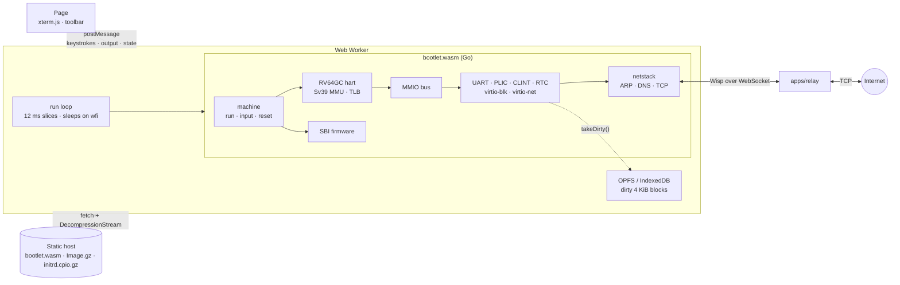
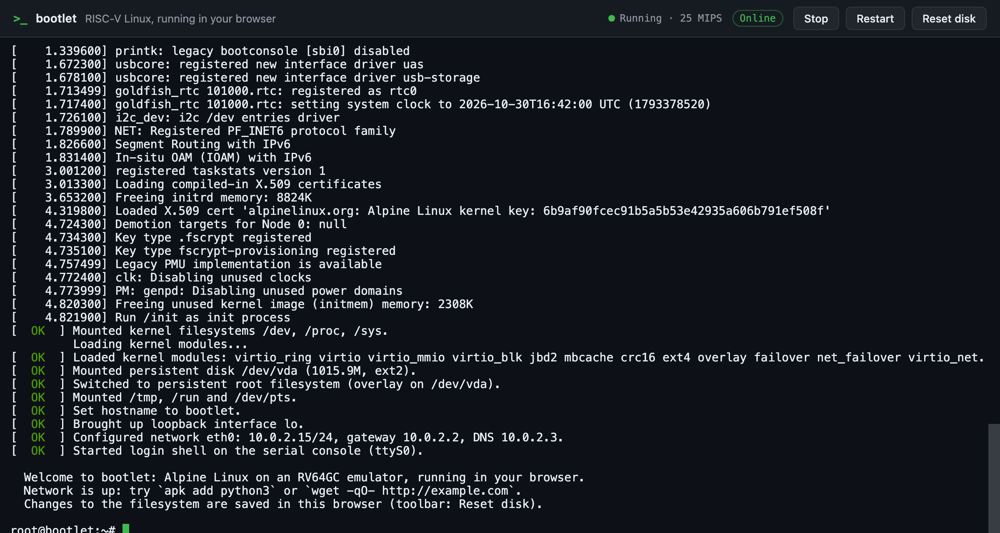
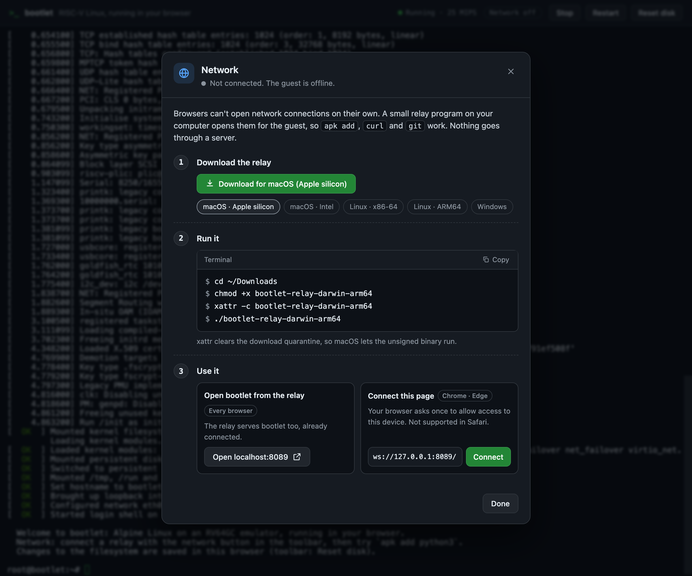

<div align="center">


# bootlet

**A real RISC-V Linux machine, booting to a shell entirely in your browser.**

[](https://github.com/bpradana/bootlet/actions/workflows/pages.yml)
[](https://bpradana.github.io/bootlet/)


[](LICENSE)

[Quick start](#quick-start) ·
[How it works](#how-it-works) ·
[Networking](#networking) ·
[Emulator API](#emulator-api) ·
[Development](#development)

</div>

---

bootlet is an RV64GC (64-bit RISC-V) machine emulator written in Go and compiled to
WebAssembly. Open the page and it boots an unmodified Linux kernel with an Alpine
userland, then hands you a root shell on a serial console. Run the small relay program
on your computer and the guest gets a network, so you can `apk add` real packages:
Python, curl, git, compilers. Everything you install or change is saved in your browser.

There is no server-side VM, container, or SSH session behind it. Every instruction runs
in a Web Worker on your machine, and the site deploys as plain static files to any host.
Browsers can't open network connections on their own, so the optional relay on your own
computer forwards the guest's traffic; nobody has to host a server. The same emulator
also builds natively, so it can be run and tested from a terminal.

```console
root@bootlet:~# apk add -q python3
root@bootlet:~# python3 -c 'import platform, sys; print("Python", sys.version.split()[0], "on", platform.machine())'
Python 3.14.10 on riscv64
```

<div align="center">

<br><sub>Python and curl installed with <code>apk</code>, still there after a page reload.</sub>
</div>

## Contents

- [Features](#features)
- [Quick start](#quick-start)
- [How it works](#how-it-works)
- [The guest](#the-guest)
- [Networking](#networking)
- [Persistent storage](#persistent-storage)
- [Emulator API](#emulator-api)
- [Performance](#performance)
- [Deployment](#deployment)
- [Development](#development)
- [Troubleshooting](#troubleshooting)
- [Known limitations](#known-limitations)
- [License](#license)

## Features

| | |
|---|---|
| 🧠 **A real RV64GC CPU** | RV64IMAFDC + Zicsr, Zifencei, and Zicntr, with M/S/U privilege modes, traps and delegation, and Sv39 paging with a software TLB. It passes all 134 official riscv-tests (`rv64ui/um/ua/uf/ud/uc/mi/si`). |
| 🐧 **An unmodified kernel** | Alpine's prebuilt `linux-lts` 6.18 boots as shipped. A Go-native SBI firmware replaces OpenSBI, and the device tree is generated at runtime. |
| 📦 **A real package manager** | musl, BusyBox, and `apk` come preinstalled and registered in apk's database, so `apk add` pulls anything from Alpine's riscv64 repositories. |
| 🌐 **Networking** | virtio-net plus a user-mode TCP/IP stack in Go (like QEMU's slirp). Guest connections travel as [Wisp](https://github.com/MercuryWorkshop/wisp-protocol) streams over a WebSocket to a relay running on your own computer, which also serves the site. |
| 💾 **Persistent root filesystem** | The whole filesystem is an overlay on a 1 GiB sparse virtio disk, saved to the Origin Private File System (or IndexedDB). Only changed 4 KiB blocks are written. **Reset disk** restores the stock system. |
| 💤 **Idles at idle** | When the guest executes `wfi`, the worker sleeps until the next timer event, keystroke, or network packet, so a VM at a prompt costs almost no CPU. |
| 🧩 **No toolchain for the guest** | `guestpack` (pure Go) downloads and verifies pinned Alpine packages and packs the initramfs. No cross compiler, Buildroot, or Docker is needed. |
| 🖥️ **Native and WASM from one codebase** | The `machine` package drives both `cmd/bootlet` (a terminal runner with direct sockets) and `cmd/wasm` (the browser build). |
| 🛠️ **One task runner** | [mise](https://mise.jdx.dev) pins Go, Node, pnpm, and zig, and defines every build, test, and dev workflow. |

## Quick start

**Just try it:** open the [demo](https://bpradana.github.io/bootlet/). It boots offline.

**With networking:** download the relay for your system from the
[latest release](https://github.com/bpradana/bootlet/releases/latest), run it, and open
**http://localhost:8089**. The relay serves bootlet itself and connects the guest to the
internet; it works in every browser. Then try:

```sh
apk add python3 curl git
curl -sI https://example.com | head -1
```

Or keep using the demo site: open the **Network off** button in the toolbar and press
**Connect**. Chrome and Edge ask once to allow the site to access this device. Safari
doesn't allow an HTTPS page to reach `localhost`, so use http://localhost:8089 there.

The toolbar can **Stop** (pause), **Start** (resume), **Restart** (reboot), and **Reset
disk** (wipe your changes). `poweroff` and `reboot` work from the shell too. Page
options: `?mem=256` sets the guest RAM in MiB (the default is 128), `?quiet` hides the
boot log, and `?relay=<ws url>` connects to a specific relay (`?relay=` for none).

### From source

You need [mise](https://mise.jdx.dev). It installs everything else.

```sh
git clone https://github.com/bpradana/bootlet.git && cd bootlet
mise install          # Go, Node, pnpm, zig
mise run relay:build  # build the site and the relay that serves it
./dist-relay/bootlet-relay   # then open http://localhost:8089
```

For frontend work, `mise run web:dev` starts Vite on http://localhost:5173 (connect it to
`mise run relay:dev` from the network menu). To boot the same machine in your terminal,
with networking through your own sockets:

```sh
mise run emu:run      # Ctrl-A x quits; the root filesystem is kept in guest/disk.img
```

## How it works



<div align="center">

<br><sub>The whole boot is visible: the kernel's log from its first instruction, then the guest's <code>[ OK ]</code> steps.</sub>
</div>

Opening the page goes through these steps:

1. The worker downloads the WASM, kernel, and initramfs in parallel, and decompresses
   the gzip files with `DecompressionStream`. The guest never decompresses anything at
   emulated speed. At the same time, it loads the saved disk blocks and opens the relay
   WebSocket.
2. Go builds the machine and copies the kernel to `0x80200000`. It places the initramfs
   and a generated device tree at the top of RAM, sets the delegation CSRs that
   firmware would normally leave behind, and enters the kernel in **S-mode**.
3. The kernel's `ecall`s (timer, IPI, remote fence, HSM, reset, debug console) are
   handled in Go, not by M-mode firmware.
4. The guest's `/init` loads the virtio drivers, mounts the disk, and makes it the upper
   layer of an overlay whose lower layer is the initramfs. It then hands over to BusyBox
   `init`, which configures `eth0` and starts a shell. Each step prints a systemd-style
   `[  OK  ]` line. From `/init` on, the console only shows kernel errors, so kernel
   messages don't tear the status lines; `dmesg` has everything.
5. The worker calls `run(12ms)` in a loop. Between slices it posts console output, feeds
   keystrokes to the UART, and moves Wisp packets between the emulator and the WebSocket.
   When the guest idles, `run` returns how long until the next timer interrupt, and the
   worker sleeps.

The device tree advertises exactly the extensions the CPU implements. A generic distro
kernel patches in code for any extension it is told about (Zbb, Svpbmt, V, and so on), so
over-claiming would crash it. `satp` rejects Sv48 and Sv57, which is how the kernel
discovers it must fall back to Sv39.

<details>
<summary><b>Source layout</b></summary>

```
packages/emulator/       Go module: the machine, with no frontend dependencies
  cpu/                   hart: decode/execute, CSRs, traps, FPU, RVC table, Sv39 MMU + TLB
  devices/               UART, PLIC, CLINT, RTC, virtio-mmio transport, virtio-blk/-net, sparse disk + journaled mkfs
  netstack/              user-mode network: ARP, ICMP, fake DNS, TCP termination; direct and Wisp upstreams
  fdt/                   device tree blob encoder
  boot/                  RISC-V Image and ELF loaders
  machine/               memory map, device tree, SBI firmware, run loop: the public API
  cmd/bootlet/           native terminal runner (-net, -relay, -disk)
  cmd/wasm/              exposes the machine to JavaScript as globalThis.bootlet
packages/shared/         UI ⇄ worker protocol (TypeScript) and the Wisp protocol (Go, wisp/)
apps/frontend/           Vite + xterm.js page, emulator worker, OPFS/IndexedDB storage, Playwright tests
apps/relay/              Wisp relay server (Go) and its Dockerfile
guest/
  manifest.toml          pinned Alpine packages (sha256), required kernel options, modules
  rootfs/                files overlaid on the initramfs: init, inittab, rcS, apk repositories, motd
  tools/cmd/guestpack    fetch → verify → extract → check → pack, plus apk's installed database
scripts/                 riscv-tests build (zig cc)
.github/workflows/       build, test, and deploy to GitHub Pages
```

</details>

## The guest

The guest is built from prebuilt **Alpine Linux 3.24 riscv64** packages, so nothing is
compiled. `mise run guest:fetch` runs `guestpack`, which does the following:

1. Downloads the kernel (`linux-lts`) and the userland (`busybox-static`, `musl`,
   `apk-tools-static`, `alpine-keys`, `ca-certificates-bundle`), and checks each against
   the sha256 pinned in `guest/manifest.toml`.
2. Decompresses the kernel to a raw RISC-V Image (21 MB, 7.1 MB gzip).
3. Reads `/boot/config-*` and fails if any option the emulator relies on is not built
   in, for example the 8250 UART, PLIC, SBI timer, and devtmpfs.
4. Unpacks every userland package and writes apk's installed database
   (`/lib/apk/db/installed`, with package checksums and per-file hashes), so `apk add`
   knows musl and friends are already present.
5. Reads BusyBox's applet table out of the binary, so every applet link is created
   at pack time instead of running `busybox --install` at every boot.
6. Adds the virtio, ext4, and overlay modules with their dependencies, resolved from
   `modules.dep`. It decompresses them and strips their signatures, because verifying a
   signature costs the guest a SHA-256 and an RSA check at emulated speed.
7. Writes a newc initramfs (8.6 MB, 4.4 MB gzip) with the `guest/rootfs` files on top.

The default kernel command line shows the boot log from the first instruction
(`earlycon=sbi`; `?quiet` appends `quiet loglevel=3`) and skips boot work that is wasted
under emulation:

```
console=ttyS0 earlycon=sbi no4lvl unaligned_scalar_speed=fast cma=0 initcall_blacklist=jent_mod_init
```

The jitter-entropy self-test alone was about half of the boot time. The kernel's RNG is
seeded from the device tree's `rng-seed` instead.

To change the guest, edit `guest/manifest.toml` (packages, modules, required options) or
the files in `guest/rootfs/`, then run `mise run guest:fetch` again.

## Networking

Browsers can't open TCP sockets, and Alpine's mirrors don't send CORS headers, so a
static page can't reach the network by itself. bootlet splits the problem in two:

- **In the emulator** (`packages/emulator/netstack`), a user-mode network gives the
  guest a LAN, like QEMU's slirp:

  | Address | Role |
  |---|---|
  | `10.0.2.15/24` | the guest (`eth0`, configured at boot) |
  | `10.0.2.2` | gateway; connections to it reach the relay host's `localhost` |
  | `10.0.2.3` | DNS: every name gets a placeholder address from `198.18.0.0/15` |

  The stack terminates the guest's TCP connections itself. When the guest connects to a
  placeholder address, it opens a stream to the **hostname**, so name resolution happens
  at the relay. The emulator never needs UDP.
- **The relay** (`apps/relay`) is a small [Wisp](https://github.com/MercuryWorkshop/wisp-protocol)
  v1 server. One WebSocket carries all of a page's streams, and the relay opens the
  real TCP connections.

### The relay on your computer

<div align="center">

<br><sub>The network menu walks through downloading, running, and connecting the relay.</sub>
</div>

The relay is one self-contained binary (about 22 MB, built per OS by
`.github/workflows/release.yml` when a `v*` tag is pushed). Run it, and it:

- listens on **127.0.0.1:8089** only, so other machines can't use it;
- serves the bootlet website there, with a `relay.json` marker that tells the page to use
  its own origin as the relay (same origin, so no browser prompt and no mixed content);
- accepts WebSocket connections from that page, from `bpradana.github.io`, and from
  `localhost` pages, and refuses other websites.

How a page finds its relay: `?relay=` if given; else the relay that served the page; else
a build-time default (`VITE_RELAY_URL`); else the relay you last connected to from the
network menu. On the public site it never connects on its own the first time, because
that would show every visitor a browser permission prompt.

| Browser | http://localhost:8089 (served by the relay) | Demo site + **Connect** |
|---|---|---|
| Chrome, Edge | ✅ | ✅ after a one-time "access other apps and services on this device" prompt |
| Safari | ✅ | ❌ blocked as mixed content (HTTPS page → `ws://`) |
| Firefox | not tested yet | not tested yet |

macOS may refuse to open the downloaded binary ("cannot be verified"). Allow it in
**System Settings → Privacy & Security**, or run `xattr -d com.apple.quarantine
bootlet-relay-darwin-*`.

The relay is restrictive by default, because an open TCP relay can be abused:

| Flag | Default | Effect |
|---|---|---|
| `-addr` | `127.0.0.1:8089` | listen address; `:8089` accepts other machines |
| `-origins` | `bpradana.github.io,localhost:*,127.0.0.1:*` | page origins allowed to connect (`*` for any); the relay's own pages are always allowed |
| `-ports` | `80,443,9418,22` | destination ports allowed (`all` for any) |
| `-allow-private` | off | loopback, private, link-local, CGNAT, and metadata addresses are refused after DNS resolution; the checked address is the one dialed, so DNS rebinding can't bypass it |
| `-max-streams` | `64` | concurrent connections per page |
| `-site` | on | serve the bundled website |

You can still host a shared relay (for example `docker build -f apps/relay/Dockerfile`,
behind TLS, with `-origins` set) and point pages at it with `?relay=wss://…` or the
`RELAY_URL` repository variable. The native runner doesn't need a relay: `-net` uses the
host's own sockets, and `-relay ws://…` goes through one to test that path.

## Persistent storage

The root filesystem survives page reloads:

- The disk is a 1 GiB **sparse** virtio block device: only written blocks take memory
  or storage, so a fresh system costs about 200 KB. BusyBox has no `mkfs`, so the
  emulator formats a new disk itself, with an 8 MiB **journal** (ext3 layout, mounted
  by the ext4 driver).
- `/init` mounts it (`commit=1`) as the upper layer of an **overlay** on top of the
  initramfs. Everything you write, from `apk add` to `/root` and `/etc`, lands on the
  disk. `/tmp` and `/run` are tmpfs.
- Every 2 seconds, and when the machine stops, the worker collects the 4 KiB blocks
  written since the last save. It stores them in the **Origin Private File System**, or
  in **IndexedDB** where OPFS sync handles aren't available. In OPFS, blocks are stored
  back to back with an index, so storage use matches what was written, not the disk size.
- **Reset disk** wipes the saved blocks and reboots into the stock system.

**Reloading or closing the tab is a power cut.** Whatever the guest wrote after the last
save is lost, so the saved disk is the device as it was at that moment. Two things make
that safe:
- **Each save is atomic.** IndexedDB saves run in one transaction. OPFS saves go through a
  write-ahead log, so a tab closed mid-save keeps the whole batch or none of it.
- **The kernel replays the journal** on the next mount, like after a crash on real
  hardware.

At worst, the last couple of seconds of changes are gone; the filesystem itself stays
consistent. `TestCrashConsistency` checks this by "reloading" a guest in the middle of
heavy file churn.

Hover the status indicator to see which backend is in use. The native runner keeps the
same disk format in a sparse file (`-disk guest/disk.img`).

## Emulator API

The `machine` package is the whole public surface. The browser build exposes the same
calls on `globalThis.bootlet`.

```go
m := machine.New(machine.Config{RAMSize: 128 << 20}) // Cmdline defaults to machine.DefaultCmdline
m.LoadKernel(image)                                   // raw RISC-V Linux Image
m.LoadInitrd(cpio)
disk := devices.NewDisk(1 << 30)                      // optional: virtio-blk at /dev/vda,
disk.Format("bootlet")                            // the guest's persistent root
m.AttachDisk(disk)
m.AttachNet(netstack.New(netstack.NewDirectUpstream())) // optional: virtio-net
m.Reset()                                             // (re)boot

for {
	res := m.Run(20 * time.Millisecond) // execute for up to 20 ms of wall-clock time
	os.Stdout.Write(m.Output())         // console bytes produced since the last call
	if res.Halted {
		break // the guest powered off
	}
	if res.Idle {
		// The hart is in wfi: sleep for res.IdleFor (negative means wait for input).
	}
	m.Input(keystrokes) // queue bytes for the serial console
}
```

| JavaScript (`globalThis.bootlet`) | Go |
|---|---|
| `create(ramMiB, cmdline)` | `machine.New` |
| `loadKernel(Uint8Array)`, `loadInitrd(Uint8Array)` | `LoadKernel`, `LoadInitrd` |
| `attachDisk(sizeMiB, idx, data)`, `takeDirty()`, `resetDisk(sizeMiB)` | `AttachDisk`, `Disk.Restore`, `Disk.TakeDirty`, `ReplaceDisk` |
| `attachNet()`, `netInput(packet)`, `netOutput()`, `netDisconnected()` | `AttachNet` with a `netstack.WispUpstream` |
| `reset()` | `Reset` |
| `run(budgetMs)` → `{output, halted, idle, idleMs, instructions}` | `Run` + `Output` |
| `input(Uint8Array)` | `Input` |

The physical memory map follows QEMU's `virt` machine:

| Address | Device |
|---|---|
| `0x0010_1000` | Goldfish RTC (host wall-clock time) |
| `0x0200_0000` | CLINT |
| `0x0c00_0000` | PLIC (31 sources, M and S contexts) |
| `0x1000_0000` | 16550A UART, IRQ 10 |
| `0x1000_1000` | virtio-mmio block device, IRQ 1 (when a disk is attached) |
| `0x1000_2000` | virtio-mmio network device, IRQ 2 (when networking is attached) |
| `0x8000_0000` | RAM (128 MiB by default, `?mem=256` in the page) |

## Performance

| | Shell prompt after | Speed while booting |
|---|---|---|
| Native (Apple Silicon) | ~1.7 s | ~90–100 MIPS |
| Browser (Chromium, WebAssembly) | ~9 s from page load, served locally | ~25–30 MIPS |

Measured with the boot log on, and with the persistent disk and networking attached,
which load their drivers before `init`. Printing the log costs under 0.1 s. Package installs are CPU-bound (decompressing and writing files at
emulated speed): `apk add lua5.4` takes about 10 s natively, and `apk add python3`
(about 45 MB) takes about 3.5 minutes in the browser. Both are one-time costs, since the
result persists.

Function calls are comparatively expensive in Go's WebAssembly output, so the hot path
is built to avoid them:

- Instruction fetch is inlined into the run loop through a cache of the current code
  page's host memory.
- Loads and stores have inlined TLB-hit fast paths into the RAM slice.
- Compressed instructions expand through a 64K-entry lookup table.
- Opcodes dispatch through a dense jump table.
- The clock is read once per 20,000 instructions.

Downloads total about 13 MB gzip: kernel 7.1 MB, initramfs 4.4 MB (half of it is
`apk.static`), WASM 1 MB, and the page itself under 100 KB.

## Deployment

`mise run build` writes a self-contained static site to `dist/`. Asset URLs are
relative, so it works from any path. It needs no special headers and no server logic;
networking comes from the relay on each user's computer.

`.github/workflows/pages.yml` runs `mise run test` on every push and pull request, and
deploys `dist/` to GitHub Pages from `main`. To enable it, set **Settings → Pages →
Source** to **GitHub Actions**.

`.github/workflows/release.yml` publishes the relay: push a tag such as `v0.2.0`, and it
builds the site and cross-compiles `bootlet-relay-<os>-<arch>` for macOS, Linux, and
Windows into a GitHub release. The network menu links to `releases/latest`.

## Development

| Task | Command |
|---|---|
| Dev server (guest + WASM + Vite) | `mise run web:dev` |
| Local network relay for development | `mise run relay:dev` |
| Relay with the site embedded (this OS · all OSes) | `mise run relay:build` · `mise run relay:dist` |
| Boot natively in the terminal, with networking | `mise run emu:run` |
| Fetch and pack the guest | `mise run guest:fetch` |
| Go unit tests (CPU + riscv-tests, devices, netstack, Wisp, relay, guest tools) | `mise run emu:test` |
| Native boot and crash tests (shell, HTTP through the stack, persistence across reboot, consistency after a simulated tab close) | `mise run emu:boot-test` (`BOOTLET_ONLINE=1` adds a real `apk add`) |
| Browser end-to-end tests (Playwright; boot, Reset disk, relay networking) | `mise run web:e2e` |
| gofmt, vet, TypeScript typecheck | `mise run lint` |
| Everything CI runs | `mise run test` |
| Production build · relay image | `mise run build` · `mise run relay:docker` |

Run `mise tasks` to list all tasks. To debug early boot, pass a verbose command line to
the native runner:

```sh
cd packages/emulator
go run ./cmd/bootlet -kernel ../../guest/out/Image -initrd ../../guest/out/initrd.cpio \
  -cmdline "console=ttyS0 earlycon=sbi loglevel=8 no4lvl initcall_debug"
```

## Troubleshooting

| Symptom | Cause and fix |
|---|---|
| The toolbar says **Network off** | No relay is connected. Run the relay and open http://localhost:8089, or press **Connect** in the network menu. |
| The toolbar says **Offline** | The relay isn't running, or it refused the page's origin (see `-origins`). The page keeps retrying, so starting the relay is enough. |
| Chrome: the connection fails without a prompt | The "access other apps and services on this device" permission was denied for the site. Allow it from the site settings (the icon left of the address bar), or use http://localhost:8089. |
| Safari: **Connect** never works | Safari blocks HTTPS pages from reaching `ws://localhost`. Open http://localhost:8089 instead. |
| `wget https://…` fails | BusyBox `wget`'s built-in TLS can't talk to many modern servers. Use `apk add curl` and `curl`. Plain HTTP `wget` works. |
| A connection is refused immediately | The relay blocks that port or address. Private and loopback destinations need `-allow-private` (local testing only). |
| `EXT4-fs error … deleted inode referenced` or `Data consistency error` | A corrupted disk. Disks from versions before the journal was added could corrupt on reload; they're deleted automatically on upgrade. If it ever happens again, use **Reset disk** (and please report it). |
| The system misbehaves after a site update | The saved overlay still holds files from the previous version (for example apk's database). Use **Reset disk**. |
| Status tooltip says changes are not saved | The browser blocks storage (for example, some private windows), or another tab holds the OPFS disk. Close the other tab and reload. |
| `guestpack: sha256 mismatch` | The mirror's file differs from the pinned one. Alpine replaced the package: update `guest/manifest.toml` to the new version and hash. |
| `guestpack: kernel lacks required built-in options` | The kernel in the manifest was built without a driver the emulator needs. Pick a kernel that has it built in (`=y`). |
| `mise install` stalls on zig | Zig mirrors can be slow. Zig is only needed for `emu:riscv-tests`; retry, or skip it for frontend work. |

## Known limitations

- **Single hart.** WebAssembly is single-threaded here, and SMP would add complexity
  without speed.
- **TCP and IPv4 only.** The guest can't send ICMP beyond the gateway, or UDP other than
  DNS. Wisp has no half-close, so a guest `shutdown(SHUT_WR)` keeps the remote side open
  until it closes.
- **Serial console only.** There is no framebuffer or graphical display.
- **Interpreter speed.** CPU-heavy work runs at tens of MIPS. A decoded-block cache, or
  translating hot blocks to WebAssembly, would be the next step.
- **Disk size vs. memory.** The disk is 1 GiB, but every block written is also held in
  the page's memory, and downloads have no backpressure from the relay. In practice a
  few hundred MB of installed software is the comfortable limit for a browser tab.
- **Recent writes can be lost.** Closing the tab loses up to about 3 s of changes (the
  journal commit interval plus the save interval). The filesystem stays consistent.
- **Guest clock pauses aren't hidden.** After Stop and Start, the guest sees the
  wall-clock time that passed.

## License

bootlet is licensed under the [MIT License](LICENSE).

The deployed site redistributes the Linux kernel, BusyBox, musl, and apk-tools as
prebuilt by [Alpine Linux](https://alpinelinux.org), under their own licenses (GPL-2.0
for Linux, BusyBox, and apk-tools; MIT for musl). Corresponding sources are available
from Alpine's [aports](https://gitlab.alpinelinux.org/alpine/aports) for the versions
pinned in `guest/manifest.toml`. The page bundles [xterm.js](https://github.com/xtermjs/xterm.js)
under the MIT License. The CPU is checked against the
[riscv-tests](https://github.com/riscv-software-src/riscv-tests) suite, which is fetched
at build time and not redistributed.
