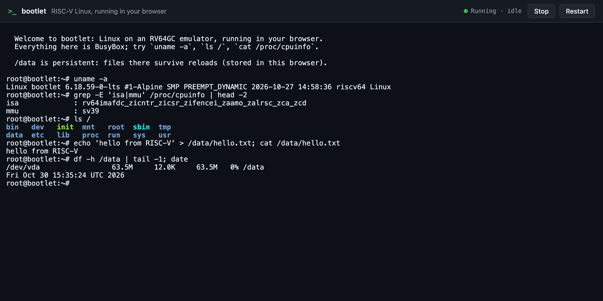
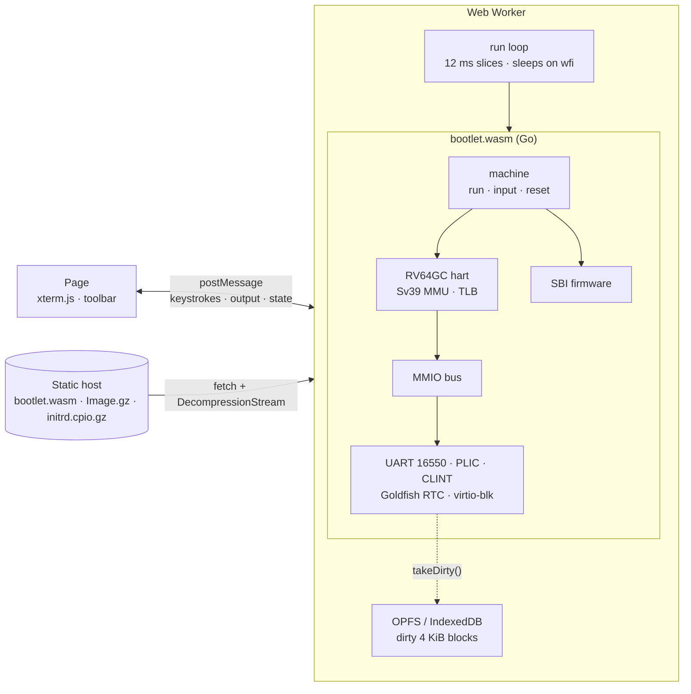

<div align="center">


# bootlet

**A real RISC-V Linux kernel, booting to a shell entirely in your browser.**

[](https://github.com/bpradana/bootlet/actions/workflows/pages.yml)
[](https://bpradana.github.io/bootlet/)


[](LICENSE)

[Quick start](#quick-start) ·
[How it works](#how-it-works) ·
[Emulator API](#emulator-api) ·
[Performance](#performance) ·
[Development](#development)

</div>

---

bootlet is an RV64GC (64-bit RISC-V) machine emulator written in Go and compiled to
WebAssembly. Open the page and it boots an unmodified Linux kernel and BusyBox userland,
then hands you a root shell on a serial console. You can run commands, edit files, and
keep files across reloads in `/data`.

There is no server-side VM, container, or SSH session behind it. Every instruction runs
in a Web Worker on your machine, and the site deploys as plain static files to any host.
The same emulator also builds natively, so it can be run and tested from a terminal.

```console
root@bootlet:~# uname -a
Linux bootlet 6.18.59-0-lts #1-Alpine SMP PREEMPT_DYNAMIC 2026-10-27 14:58:36 riscv64 Linux
root@bootlet:~# grep -E 'isa|mmu' /proc/cpuinfo | head -2
isa             : rv64imafdc_zicntr_zicsr_zifencei_zaamo_zalrsc_zca_zcd
mmu             : sv39
```

<div align="center">

<br><sub>Linux 6.18 at a root prompt, about five seconds after opening the page.</sub>
</div>

## Contents

- [Features](#features)
- [Quick start](#quick-start)
- [How it works](#how-it-works)
- [The guest](#the-guest)
- [Persistent storage](#persistent-storage)
- [Emulator API](#emulator-api)
- [Performance](#performance)
- [Deployment](#deployment)
- [Development](#development)
- [Troubleshooting](#troubleshooting)
- [Known limitations](#known-limitations)
- [License](#license)

## Features

| | |
|---|---|
| 🧠 **A real RV64GC CPU** | RV64IMAFDC + Zicsr, Zifencei, and Zicntr, with M/S/U privilege modes, traps and delegation, and Sv39 paging with a software TLB. It passes all 134 official riscv-tests (`rv64ui/um/ua/uf/ud/uc/mi/si`). |
| 🐧 **An unmodified kernel** | Alpine's prebuilt `linux-lts` 6.18 boots as shipped. A Go-native SBI firmware replaces OpenSBI, and the device tree is generated at runtime. |
| 🌐 **Browser-only execution** | The emulator runs in a Web Worker, so the page stays responsive. No SharedArrayBuffer is used, so no COOP/COEP headers are needed. |
| 💤 **Idles at idle** | When the guest executes `wfi`, the worker sleeps until the next timer event or keystroke, so a VM sitting at a prompt costs almost no CPU. |
| 💾 **Persistent `/data`** | A virtio block device backed by the Origin Private File System, falling back to IndexedDB. Only changed 4 KiB blocks are written. |
| 📦 **No toolchain for the guest** | `guestpack` (pure Go) downloads and verifies pinned Alpine packages and packs the initramfs. No cross compiler, Buildroot, or Docker is needed. |
| 🖥️ **Native and WASM from one codebase** | The `machine` package drives both `cmd/bootlet` (a terminal runner) and `cmd/wasm` (the browser build), with the same API. |
| 🛠️ **One task runner** | [mise](https://mise.jdx.dev) pins Go, Node, pnpm, and zig, and defines every build, test, and dev workflow. |

## Quick start

You need [mise](https://mise.jdx.dev). It installs everything else.

```sh
git clone https://github.com/bpradana/bootlet.git && cd bootlet
mise install          # Go, Node, pnpm, zig
mise run web:dev      # fetch the guest, build the WASM, start Vite on http://localhost:5173
```

Open **http://localhost:5173**. The page downloads the emulator and guest (about 9 MB
gzip), boots, and drops you at `root@bootlet:~#`. The toolbar can **Stop** (pause),
**Start** (resume), and **Restart** (reboot) the machine. `poweroff` and `reboot` work from
the shell too.

To boot the same machine in your terminal instead:

```sh
mise run emu:run      # Ctrl-A x quits; /data is kept in guest/disk.img
```

## How it works



Opening the page goes through these steps:

1. The worker downloads the WASM, kernel, and initramfs in parallel, and decompresses
   the gzip files with `DecompressionStream`. The guest never decompresses anything at
   emulated speed. In parallel, it opens the persistent disk.
2. Go builds the machine and copies the kernel to `0x80200000`. It places the initramfs
   and a generated device tree at the top of RAM, sets the delegation CSRs that
   firmware would normally leave behind, and enters the kernel in **S-mode**.
3. The kernel's `ecall`s (timer, IPI, remote fence, HSM, reset, debug console) are
   handled in Go, not by M-mode firmware.
4. The worker calls `run(12ms)` in a loop. It posts console output between slices, and
   feeds keystrokes into the UART's receive queue. When the guest idles, `run` returns
   how long until the next timer interrupt and the worker sleeps.

The device tree advertises exactly the extensions the CPU implements. A generic distro
kernel patches in code for any extension it is told about (Zbb, Svpbmt, V, and so on), so
over-claiming would crash it. `satp` rejects Sv48 and Sv57, which is how the kernel
discovers it must fall back to Sv39.

<details>
<summary><b>Source layout</b></summary>

```
packages/emulator/       Go module: the machine, with no frontend dependencies
  cpu/                   hart: decode/execute, CSRs, traps, FPU, RVC table, Sv39 MMU + TLB
  devices/               UART 16550, PLIC, CLINT, Goldfish RTC, virtio-mmio block, sparse disk + ext2 mkfs
  fdt/                   device tree blob encoder
  boot/                  RISC-V Image and ELF loaders
  machine/               memory map, device tree, SBI firmware, run loop: the public API
  cmd/bootlet/           native terminal runner
  cmd/wasm/              exposes the machine to JavaScript as globalThis.bootlet
packages/shared/         UI ⇄ worker message protocol (TypeScript)
apps/frontend/           Vite + xterm.js page, emulator worker, OPFS/IndexedDB storage, Playwright tests
guest/
  manifest.toml          pinned Alpine packages (sha256), required kernel options, modules
  rootfs/                files overlaid on the initramfs: init, inittab, rcS, profile, motd
  tools/cmd/guestpack    fetch → verify → extract → check → pack
scripts/                 riscv-tests build (zig cc)
.github/workflows/       build, test, and deploy to GitHub Pages
```

</details>

## The guest

The guest is built from prebuilt **Alpine Linux 3.24 riscv64** packages, so nothing is
compiled. `mise run guest:fetch` runs `guestpack`, which does the following:

1. Downloads `linux-lts` and `busybox-static`, and checks them against the sha256 pinned
   in `guest/manifest.toml`.
2. Decompresses the kernel to a raw RISC-V Image (21 MB, 7.1 MB gzip).
3. Reads `/boot/config-*` and fails if any option the emulator relies on is not built
   in, for example the 8250 UART, PLIC, SBI timer, and devtmpfs.
4. Reads BusyBox's applet table out of the binary, so every applet link is created
   at pack time instead of running `busybox --install` at every boot.
5. Adds the virtio and ext4 modules with their dependencies, resolved from
   `modules.dep`. It decompresses them and strips their signatures, because verifying a
   signature costs the guest a SHA-256 and an RSA check at emulated speed.
6. Writes a newc initramfs: BusyBox, the modules, and the `guest/rootfs` overlay.

The default kernel command line also skips boot work that is wasted under emulation:

```
console=ttyS0 quiet loglevel=3 no4lvl unaligned_scalar_speed=fast cma=0 initcall_blacklist=jent_mod_init
```

The jitter-entropy self-test alone was about half of the boot time. The kernel's RNG is
seeded from the device tree's `rng-seed` instead.

To change the guest, edit `guest/manifest.toml` (packages, modules, required options) or
the files in `guest/rootfs/`, then run `mise run guest:fetch` again.

## Persistent storage

`/data` is a 64 MiB virtio block device that survives page reloads:

- The disk is **sparse** in memory, so an empty disk holds a few metadata blocks. BusyBox
  has no `mkfs.ext2`, so the emulator formats a fresh disk as ext2 itself.
- The guest loads the drivers and mounts the disk with `-o sync` in the background, so
  the shell isn't delayed.
- Every 2 seconds, and when the machine stops, the worker collects the 4 KiB blocks
  written since the last save. It stores them in the **Origin Private File System**, or
  in **IndexedDB** where OPFS sync handles aren't available.

Hover the status indicator to see which backend is in use. To wipe the disk, clear the
site's data in your browser. The native runner keeps the same disk format in a sparse
file (`-disk guest/disk.img`).

## Emulator API

The `machine` package is the whole public surface. The browser build exposes the same
calls on `globalThis.bootlet`.

```go
m := machine.New(machine.Config{RAMSize: 128 << 20}) // Cmdline defaults to machine.DefaultCmdline
m.LoadKernel(image)                                   // raw RISC-V Linux Image
m.LoadInitrd(cpio)
disk := devices.NewDisk(64 << 20)                     // optional: virtio-blk at /dev/vda,
disk.FormatExt2("bootlet")                            // mounted by the guest at /data
m.AttachDisk(disk)
m.Reset()                                             // (re)boot

for {
	res := m.Run(20 * time.Millisecond) // execute for up to 20 ms of wall-clock time
	os.Stdout.Write(m.Output())         // console bytes produced since the last call
	if res.Halted {
		break // the guest powered off
	}
	if res.Idle {
		// The hart is in wfi: sleep for res.IdleFor (negative means wait for input).
	}
	m.Input(keystrokes) // queue bytes for the serial console
}
```

| JavaScript (`globalThis.bootlet`) | Go |
|---|---|
| `create(ramMiB, cmdline)` | `machine.New` |
| `loadKernel(Uint8Array)`, `loadInitrd(Uint8Array)` | `LoadKernel`, `LoadInitrd` |
| `attachDisk(sizeMiB, idx, data)`, `takeDirty()` | `AttachDisk`, `Disk.Restore`, `Disk.TakeDirty` |
| `reset()` | `Reset` |
| `run(budgetMs)` → `{output, halted, idle, idleMs, instructions}` | `Run` + `Output` |
| `input(Uint8Array)` | `Input` |

The physical memory map follows QEMU's `virt` machine:

| Address | Device |
|---|---|
| `0x0010_1000` | Goldfish RTC (host wall-clock time) |
| `0x0200_0000` | CLINT |
| `0x0c00_0000` | PLIC (31 sources, M and S contexts) |
| `0x1000_0000` | 16550A UART, IRQ 10 |
| `0x1000_1000` | virtio-mmio block device, IRQ 1 (when a disk is attached) |
| `0x8000_0000` | RAM (128 MiB by default) |

## Performance

| | Shell prompt after | Speed while booting |
|---|---|---|
| Native (Apple Silicon) | ~1.1 s | ~90–100 MIPS |
| Browser (Chromium, WebAssembly) | ~5.5 s from page load, served locally | ~25–30 MIPS |

Function calls are comparatively expensive in Go's WebAssembly output, so the hot path
is built to avoid them:

- Instruction fetch is inlined into the run loop through a cache of the current code
  page's host memory.
- Loads and stores have inlined TLB-hit fast paths into the RAM slice.
- Compressed instructions expand through a 64K-entry lookup table.
- Opcodes dispatch through a dense jump table.
- The clock is read once per 20,000 instructions.

Downloads total about 9 MB gzip: kernel 7.1 MB, initramfs 1.1 MB, WASM 0.9 MB, and the
page itself under 100 KB.

## Deployment

`mise run build` writes a self-contained static site to `dist/`. Asset URLs are
relative, so it works from any path. It needs no special headers and no server logic.

`.github/workflows/pages.yml` runs `mise run test` on every push and pull request, and
deploys `dist/` to GitHub Pages from `main`. To enable it, set **Settings → Pages →
Source** to **GitHub Actions**.

## Development

| Task | Command |
|---|---|
| Dev server (guest + WASM + Vite) | `mise run web:dev` |
| Boot natively in the terminal | `mise run emu:run` |
| Fetch and pack the guest | `mise run guest:fetch` |
| Go unit tests + riscv-tests | `mise run emu:test` (builds riscv-tests with `zig cc` on first run) |
| Native boot test (shell commands, `/data` across reboot) | `mise run emu:boot-test` |
| Browser end-to-end tests (Playwright) | `mise run web:e2e` |
| gofmt, vet, TypeScript typecheck | `mise run lint` |
| Everything CI runs | `mise run test` |
| Production build | `mise run build` |

Run `mise tasks` to list all tasks. To debug early boot, pass a verbose command line to
the native runner:

```sh
cd packages/emulator
go run ./cmd/bootlet -kernel ../../guest/out/Image -initrd ../../guest/out/initrd.cpio \
  -cmdline "console=ttyS0 earlycon=sbi loglevel=8 no4lvl initcall_debug"
```

## Troubleshooting

| Symptom | Cause and fix |
|---|---|
| `guestpack: sha256 mismatch` | The mirror's file differs from the pinned one. Alpine replaced the package: update `guest/manifest.toml` to the new version and hash. |
| `guestpack: kernel lacks required built-in options` | The kernel in the manifest was built without a driver the emulator needs. Pick a kernel that has it built in (`=y`). |
| Status tooltip says `/data is not persistent` | The browser blocks storage (for example, some private windows), or another tab holds the OPFS disk. Close the other tab and reload. |
| `mise install` stalls on zig | Zig mirrors can be slow. Zig is only needed for `emu:riscv-tests`; retry, or skip it for frontend work. |
| `emu:test` reports riscv-tests skipped | They are not built yet. Run `mise run emu:riscv-tests`. |
| The page works locally but not when deployed | Make sure `dist/guest/*.gz` and `dist/bootlet.wasm` were uploaded. The build copies them from `guest/out`, so run `guest:fetch` first. |

## Known limitations

- **Single hart.** WebAssembly is single-threaded here, and SMP would add complexity
  without speed.
- **No network.** There is no NIC; the guest is offline by design.
- **Serial console only.** There is no framebuffer or graphical display.
- **Interpreter speed.** A generic distro kernel boots in seconds, but CPU-heavy work runs
  at tens of MIPS. A decoded-block cache or translating hot blocks to WebAssembly would
  be the next step.
- **Guest clock pauses aren't hidden.** After Stop and Start, the guest sees the
  wall-clock time that passed.

## License

bootlet is licensed under the [MIT License](LICENSE).

The deployed site redistributes the Linux kernel and BusyBox, both under the GNU GPL
version 2, as prebuilt by [Alpine Linux](https://alpinelinux.org). Corresponding
sources are available from Alpine's
[aports](https://gitlab.alpinelinux.org/alpine/aports) for the versions pinned in
`guest/manifest.toml`. The page bundles [xterm.js](https://github.com/xtermjs/xterm.js)
under the MIT License. The CPU is checked against the
[riscv-tests](https://github.com/riscv-software-src/riscv-tests) suite, which is fetched
at build time and not redistributed.
